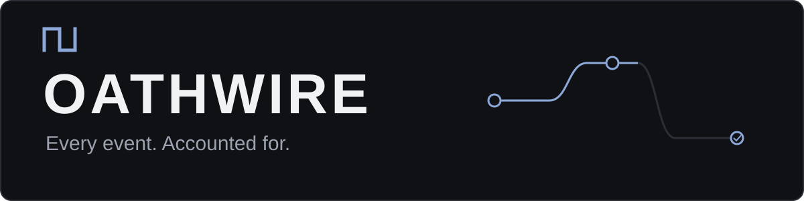
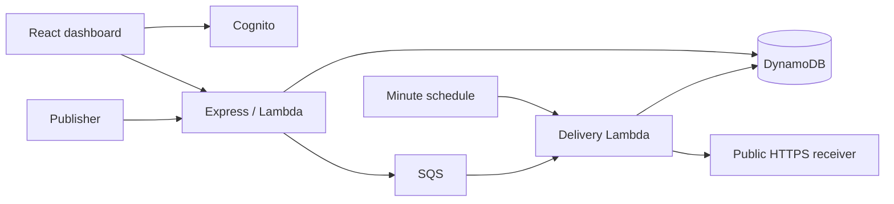

# Oathwire

Oathwire accepts events and delivers signed HTTPS webhooks through a persistent queue. It records delivery attempts, retries temporary endpoint failures, and lets the owner replay failed deliveries. Access is by invitation.

**Status:** invitation-only AWS beta at [oathwire.zadaks.com](https://oathwire.zadaks.com). Sign-in, signed delivery, retry recovery, six-attempt exhaustion, replay history and key revocation passed a controlled live run. See [verification](docs/verification.md) for evidence and remaining checks. Do not treat this as a production service yet.

The [pre deployment audit](docs/pre-deployment-audit.md) inventories the AWS resources, models Frankfurt costs, and records readiness. [Deployment preparation](docs/deployment-preparation.md) resolved the initial account concurrency blocker. The deployed beta uses reserved concurrency of 3 per function and SQS maximum concurrency of 2. The workflow only prepares a change set for review after owner authorization.

- Cognito hosted sign in with Authorization Code and PKCE.
- Owned projects, destination subscriptions, hashed publishing keys and revocation.
- Atomic event acceptance, idempotency per project and daily quotas.
- SQS delivery jobs, conditional leases, bounded retries and scheduled recovery.
- HMAC-SHA256 signatures, pinned public DNS resolution and no redirects.
- React dashboard with event, delivery and attempt history; manual replay.



The API and worker use TypeScript, Node.js 24, AWS SDK v3, Express and Zod. The frontend uses React and Vite. AWS SAM describes DynamoDB, SQS, API Gateway, Cognito, S3, CloudFront, logs, alarms and billing notifications.

## Local setup

Install Node.js 24 and npm. From this directory:

```sh
npm ci
npm run check
npm run dev:web
```

Without configuration, the frontend displays a setup notice. Connect Cognito and the API before signing in.

Copy `.env.example` to `.env` and set the AWS resources and Cognito values described in [deployment](docs/deployment.md). To run the local API against those resources:

```sh
node --env-file=.env --import tsx --watch apps/api/src/local.ts
```

The Vite frontend reads the root `.env`. Restart Vite after changing it. The backend verifies real Cognito access tokens even locally. Public HTTPS destination restrictions also remain enabled locally.

## Publish an event

Create a project, destination, and publishing key in the dashboard, then:

```sh
curl -X POST "$API_URL/v1/events" \
  -H "Authorization: Bearer $OATHWIRE_API_KEY" \
  -H 'Content-Type: application/json' \
  -H 'Idempotency-Key: order-1842' \
  -d '{"type":"order.created","data":{"orderId":"1842"}}'
```

HTTP 202 means the event and delivery work were stored. It does not mean a receiver processed the event. Delivery is **at least once**, with no ordering guarantee. Receivers must deduplicate.

## Tests

`npm test` runs security, service, failure recovery and React tests without AWS credentials. The DynamoDB SDK integration test is skipped unless `DYNAMODB_LOCAL_URL` is set. CI enables it using DynamoDB Local.

To run it locally, start the official [DynamoDB Local](https://docs.aws.amazon.com/amazondynamodb/latest/developerguide/DynamoDBLocal.html) image or Java distribution on port 8000, then:

```powershell
$env:DYNAMODB_LOCAL_URL='http://localhost:8000'
npm run check
```

Integration tests use dummy credentials, reject endpoints outside loopback, and create/delete only uniquely named test tables. They never fall back to AWS.

## Deploying and operating

Read [deployment](docs/deployment.md) before creating paid resources. Deployment is manual and requires an approved AWS account, OIDC role, and budget email. [API reference](docs/api.md), [architecture](docs/architecture.md), and a [controlled receiver](examples/receiver.ts) explain the flow.

Current limits: three projects including archives, five destination configurations including retired entries, three active keys per project, 16 KiB per event, 1,000 events per UTC day, six attempts, and seven days of history. Replays are limited to five per project per minute. Dashboard statistics cover a bounded recent sample, not lifetime traffic. There is no billing, team model, arbitrary filtering, payload transformation, or custom request headers.

MIT licensed; see [LICENSE](LICENSE).
