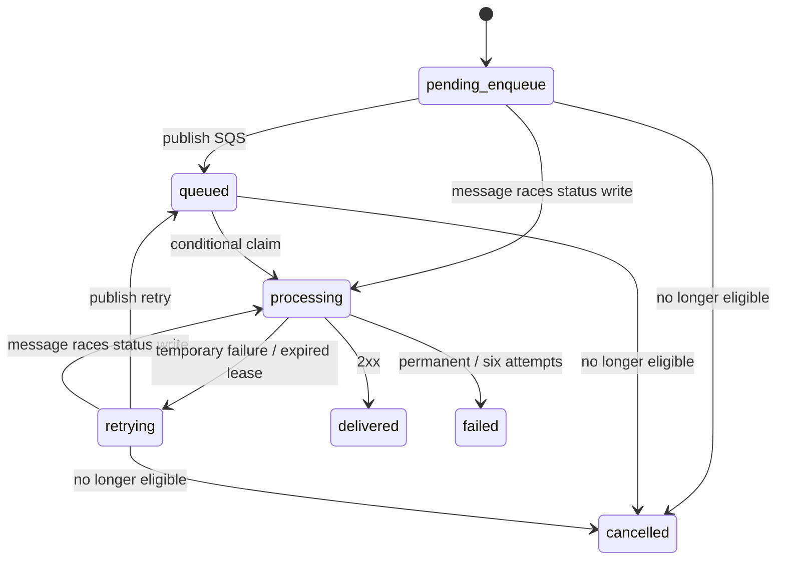

# Architecture

The API owns validation and durable acceptance. The worker owns outbound delivery. They share TypeScript modules for data models, validation and persistence.

## Storage and access patterns

The main DynamoDB table has a string `pk`, entity versions for optimistic concurrency, and three sparse indexes:

| Access                             | Key                                           |
| ---------------------------------- | --------------------------------------------- |
| Project, event, delivery, key hash | Base table `pk`, consistent reads             |
| Projects by owner                  | Listing: `ACCOUNT#owner`, `PROJECT#time#id`   |
| Events by project                  | Listing: project ID, `EVENT#time#id`          |
| Deliveries by event                | Listing: event ID, `DELIVERY#...`             |
| Attempts by delivery               | Listing: delivery ID, `ATTEMPT#number`        |
| Deliveries by destination/time     | DestinationHistory: destination ID, `time#id` |
| Recoverable work                   | Work: `WORK`, numeric `workAt`                |

Destinations and active key metadata are embedded in the small project record. Conditional checks against its version ensure ingestion uses one eligible configuration snapshot. Signing secrets are in a separate encrypted table; regular API responses never read them into destination DTOs. The API can rotate secrets; the worker can only read/check them. DynamoDB encryption at rest protects storage media, not a compromised IAM principal authorized to read the table.

Event, delivery, attempt, quota and idempotency rows expire after seven days. Application reads reject expired resources before TTL physically removes them. Projects and destination secrets persist until the stack is removed. Revoked key hashes remain inert records. Global indexes are eventually consistent; listings can lag writes. Authorization and claims always use consistent reads from the base table.

Each list reads at most 50 records. Event filters apply within the selected page; an empty filtered page may still have a next cursor. Dashboard statistics describe the latest 50 retained events and first 50 deliveries per event, including replay jobs; they are not lifetime totals. No table scans are used.

## Acceptance

A single DynamoDB transaction checks the project and publishing key versions, increments the UTC daily quota, and creates the event, all matching deliveries, and optional idempotency record. A conditional idempotency write prevents duplicate acceptance under concurrency. The canonical hash recursively sorts object keys and preserves array order. A reused key with a different accepted request returns 409. Repeating an accepted request does not increment quota.

API key revocation and configuration edits conflict with concurrent acceptance; the operation that commits first determines eligibility. Disabled projects reject even an idempotent publishing retry. Idempotency lasts seven days from initial acceptance. HTTP 202 is returned only after the acceptance transaction commits. Zero matches is a real accepted event with zero deliveries.

## Delivery lifecycle

Every queue message carries a delivery ID and generation. Conditional version writes allow one claim of that generation. Claiming creates an unfinished attempt and a processing lease of 30 seconds in the same transaction. The HTTPS deadline is five seconds, including DNS. Known outcomes atomically finalize the attempt and delivery. A stale or expired owner cannot replace a newer outcome.

2xx acknowledges delivery. 408, 425, 429, 5xx and selected temporary network failures retry. Other statuses (including redirects), invalid TLS and unsafe destinations fail permanently. Retry waits after attempts 1 to 5 are 10, 30, 90, 300, 900 seconds. A valid 429 Retry-After can lengthen a wait up to 900 seconds. Six claims exhaust the delivery, including attempts whose outcome became unknown. There is no hidden HTTP client retry or jitter.

Before each claim, the worker rechecks project and destination eligibility and event retention. Retiring or disabling prevents later claims. An already claimed request may finish. Destination URLs are immutable: replacement requires registering a new configuration. Rotation affects future claims immediately; a request already in flight may use the old secret. Receivers should coordinate the rotation and briefly accept both secrets if needed.

## Queue recovery

DynamoDB and SQS cannot commit together. Pending work therefore has a durable Work index entry before any queue operation. The API publishes after committing acceptance. Enqueue publication precedes updating the record to queued. Duplicate publication is safe because claims use generation and version conditions.

Retry state and the next generation commit before the retry message is published. The current SQS record is acknowledged only after processing returns; infrastructure exceptions return a partial batch failure. A minute schedule queries up to five pages of 100 due work entries, rereads each base record and republishes missed work. Queued work remains indexed for a two minute watchdog after its due time, so lost or prematurely acknowledged messages can be recovered.

An expired processing lease finalizes its in progress attempt as `unknown`, increments the generation, and schedules another claim unless six attempts were consumed. Recovery itself uses a transaction and can run twice safely. An HTTP success followed by a persistence failure is inherently ambiguous; a later attempt can duplicate the request. Delivery can occur more than once.

The SQS DLQ captures repeated infrastructure or failures caused by malformed messages, not ordinary destination failures. A delivery's due record remains the source of recovery even if its queue message enters the DLQ. Persistent infrastructure failures need operator attention; monitor logs and alarms. A metric filter also alarms on partial batch failures and individual reconciliation failures that do not appear as Lambda invocation errors. Reconciliation stops admitting further work after a soft budget of 12 seconds; remaining due records stay indexed for the next invocation. An individual SDK call can still outlast the budget. Recovery is bounded, not a promise of unlimited throughput or indefinite retention.

Manual replay creates a new delivery and preserves the failed original. Replay is limited by a counter per project per minute and an idempotency key per delivery. It uses the original event's expiration time; replay does not extend payload retention.

## Network safety and cost

Only DNS hostnames over HTTPS/443 are accepted. The worker validates every A/AAAA result and rejects private and reserved ranges, then injects the selected validated address into the actual new socket lookup. The original hostname remains the TLS/SNI identity. No redirects, arbitrary headers, insecure TLS, IP destinations or buffering of response bodies are allowed. The absolute deadline also covers DNS lookup. Network protection has unit/transport tests, but still requires live AWS smoke testing before public use.

API Gateway throttles requests, conditional daily counters limit publishers, and worker concurrency is small. These are safeguards rather than a hard cap on AWS charges. CloudWatch and AWS Budgets need ongoing review. The system deliberately provides no event ordering, infinite retention, guaranteed destination processing, or recovery from indefinite cloud outages.
